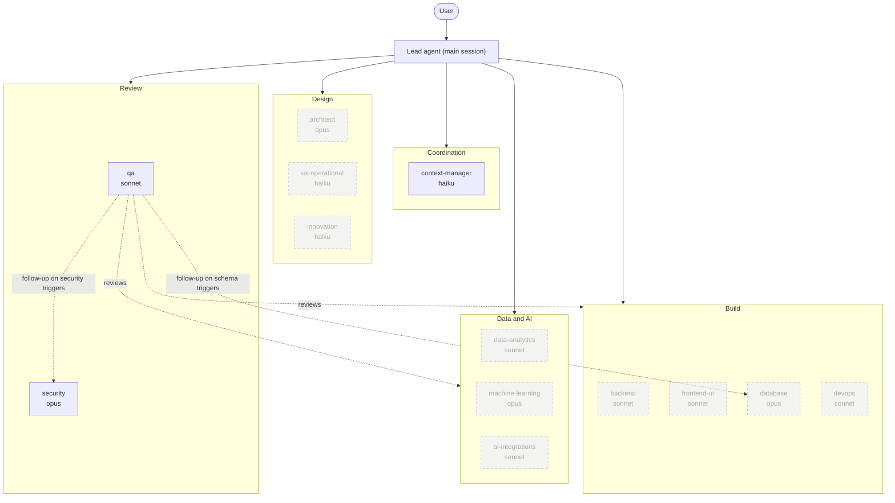

# Agent Workflow Protocol

A reusable base for AI-assisted software work. It gives coding agents — Claude
Code (`.claude/CLAUDE.md`), and Codex and opencode (`AGENTS.md`) — a clear, low-token
operating protocol: how to read context, how to track work, who reviews what,
and when.

The design goals, in order: **correctness, maintainability, clarity,
reusability, security, and low token usage.**

---

## How it works in 30 seconds

1. **The protocol lives in small modules** under `.agents/protocol/` (the single
   source of truth). `.claude/CLAUDE.md` imports them with `@import` (Claude Code expands
   them). `AGENTS.md` is generated by flattening the modules `CLAUDE.md` imports into
   plain text (`python3 .agents/planning/scripts/build_agents.py`) so Codex and opencode
   get the same always-on protocol.
2. **Most of the protocol loads every session** (the "always-on" base).
   Niche modules (database, feature tracking, data/ML rules, review governance,
   project setup) load **only when the task needs
   them** to keep the base small.
3. **Specialist work is delegated to subagents** in `.claude/agents/`. Each is a
   real Claude Code subagent with its own model and tools, and runs in an
   **isolated context** so heavy reading doesn't bloat the main thread. A new
   project starts with 3 core agents; a **mandatory first task** asks you for the
   project objective and tools, then installs the specialists that project
   needs from the catalog in `.agents/agent-catalog/`.
4. **Work is tracked as tasks** (and grouped into features when useful). A task
   isn't `Done` until QA — and Security when risk applies — has reviewed it.
5. **One command checks everything**: `python3 .agents/planning/scripts/check.py` runs
   the project's lint/tests, and validates task docs against
   `.agents/config/review_rules.json`. It prints only failures, and runs from a
   Claude Code hook, the pre-commit hook, and CI — so quality does not depend on
   an agent remembering to check.

---

## Repository structure

```text
.
├── AGENTS.md                  # Generated: flattened always-on protocol (Codex / opencode)
├── README.md                  # This guide (replace it with your project's README when ready)
├── .gitignore
│
├── .agents/                   # Everything the agent workflow needs
│   ├── protocol/              # The protocol itself, split into modules (00–13)
│   ├── agent-catalog/         # 10 optional subagents, installed by project setup
│   ├── config/
│   │   ├── review_rules.json  # Machine-readable review policy (used by the validator)
│   │   ├── checks.json        # The project's check commands (lint, tests, build)
│   │   └── org.json           # Areas and review lines for the organization chart
│   ├── context/               # Current-state snapshot; project_profile.md after setup
│   ├── hooks/                 # Git hooks (pre-commit regenerates AGENTS.md, runs checks)
│   └── planning/              # Working data
│       ├── tasks/
│       │   ├── active_task.md      # Pointer to the current task
│       │   ├── _templates/         # task.md (includes the QA record), plan.md, handoff.md
│       │   └── YYYY/MM/{id}-{name}/    # One folder per non-trivial task
│       ├── features/
│       │   ├── _templates/         # plan.md, changes_current.md, qa.md
│       │   └── {id}-{name}/        # One folder per feature
│       ├── docs/                   # Reusable references (index, glossary, lessons/)
│       └── scripts/
│           ├── check.py                # Runs every check; prints only failures
│           ├── tests/                  # Unit tests for the scripts
│           ├── validate_task_docs.py   # Validates task docs against review_rules.json
│           ├── build_agents.py         # Regenerates AGENTS.md from the protocol modules
│           ├── build_org.py            # Regenerates the organization chart in this README
│           └── new_task.py             # Creates the next task folder from the template
│
├── .claude/                   # Claude Code specifics
│   ├── CLAUDE.md              # Thin index: imports the always-on protocol modules
│   ├── agents/                # Installed subagents: 3 core + those chosen at setup
│   ├── skills/                # setup-project, new-task, qa-review
│   ├── settings.json          # Shared permission allowlist + Stop hook that runs check.py
│   └── settings.local.json    # Personal permission overrides (gitignored)
│
└── .github/workflows/         # CI: runs check.py on every push and pull request
```

The root holds only `README.md` and what tools require there: `AGENTS.md` (Codex
and opencode look for it at the root), `.gitignore`, and the tool folders.
Everything else lives under `.agents/`, so the root stays free for your project's own code.

---

## The protocol system

`.agents/protocol/` is the single source of truth. The two entry files deliver
it differently, so each tool gets the protocol the way it reads files:

- **`.claude/CLAUDE.md`** stays a thin index that imports modules with `@path` syntax;
  Claude Code expands the imports at load time (and skips the on-demand modules
  for token efficiency).
- **`AGENTS.md`** is **generated** by flattening the modules that `CLAUDE.md`
  imports (the always-on set) into plain text,
  because Codex and opencode read `AGENTS.md` literally and do not expand
  imports.

To change a rule, edit the module under `.agents/protocol/`, then regenerate
`AGENTS.md`:

```bash
python3 .agents/planning/scripts/build_agents.py
```

`AGENTS.md` carries a "generated — do not edit by hand" header; edit the modules,
not the flattened file.

A committed **pre-commit hook** automates this. Once enabled (see *Getting
started*), it runs the build script and re-stages `AGENTS.md` on every commit,
then runs the project checks. A unit test also fails when `AGENTS.md` does not
match the modules, so CI catches drift even if the hook was never enabled.

### Protocol modules

| Module | Loaded | Covers |
|---|---|---|
| `00-authority.md` | always | Protocol authority and precedence; subagents are the source of truth for role behavior |
| `01-foundations.md` | always | Project purpose, **project setup gate**, core reading order, **on-demand module index**, create-on-demand rule |
| `02-task-tracking.md` | always | Task tracking rules, verifiable acceptance criteria, statuses and review flow, completion rule |
| `03-token-budget.md` | always | Token budget tiers (Low/Medium/High) and consumption strategy |
| `04-work-modes-activation.md` | always | Work modes, agent activation table, activation limits, **delegation for token efficiency** |
| `05-agent-roles.md` | always | Role → subagent map (core vs installed on setup) |
| `06-methodology-docs.md` | always | Development methodology, test-first rule, documentation rules |
| `07-database.md` | **on-demand** | Database coordination protocol and schema simplicity rules |
| `08-feature-tracking.md` | **on-demand** | Detailed feature-tracking conventions |
| `09-rules.md` | always | No-Go rules |
| `10-review-output.md` | always | Review severity scale and expected final-response format |
| `11-project-setup.md` | **on-demand** | Mandatory first task: ask objective and tools, install the needed subagents |
| `12-data-ml-rules.md` | **on-demand** | Excel/CSV data-processing rules and machine-learning rules |
| `13-review-governance.md` | **on-demand** | QA scheduling, non-negotiable triggers, proportionality, `other` rationale, verification and lessons rules |

On-demand modules are **not** imported by `.claude/CLAUDE.md` nor inlined in
`AGENTS.md`. The agent reads them only when the task matches a trigger listed in `01-foundations.md`
(e.g. read `07-database.md` for any schema/migration/persistence change).

---

## Agents

The template ships 13 **real Claude Code subagents**. Each has YAML frontmatter
(`name`, `description`, `tools`, `model`) so Claude Code can register and
delegate to it. Only the ones in `.claude/agents/` are active:

- **Core (always installed):** `qa`, `security`, `context-manager`.
- **Catalog (`.agents/agent-catalog/`):** the other 10. They are inert until
  project setup copies the ones your project needs into `.claude/agents/` and
  tailors them to your stack.

Run `/agents` to see the installed ones. The main agent delegates
a step to a subagent; the subagent works in its own context and returns only the
conclusion.

**Cross-tool note:** subagents are a Claude Code feature. Codex and opencode read
the shared protocol through `AGENTS.md` but use their own agent mechanisms; they
do not consume `.claude/agents/`.

Models are tiered to balance capability against cost:

| Subagent | Model | Can edit files | Use for |
|---|---|---|---|
| `architect` | opus | no | Module boundaries, integration plans, refactors (advisory) |
| `database` | opus | yes | Schema, migrations, constraints, integrity |
| `machine-learning` | opus | yes | Targets, baselines, evaluation, leakage prevention |
| `qa` | sonnet (opus for `Deep`) | yes (told to edit task docs only) | Verification, acceptance, the follow-up-review decision |
| `security` | opus | no | Secrets, trust boundaries, uploads, sensitive data (advisory) |
| `backend` | sonnet | yes | APIs, services, validation, business rules |
| `frontend-ui` | sonnet | yes | Screens, forms, states, operator workflows |
| `data-analytics` | sonnet | yes | Excel/CSV, transformations, metrics, model prep |
| `ai-integrations` | sonnet | yes | AI APIs, prompts, model routing, automations |
| `devops` | sonnet | yes | Deployment, CI/CD, runtime, release safety |
| `context-manager` | haiku | yes (told to edit context files only) | Decides what to read/skip/update; keeps context cheap |
| `innovation` | haiku | no | Practical improvement proposals (advisory) |
| `ux-operational` | haiku | no | Workflow-friction critique (advisory, optional) |

"Can edit files: no" means the agent has no `Write`/`Edit` tools (it has `Read`,
`Bash`, `Glob`, `Grep`). It still has `Bash`, so this is a strong default, not a
sandbox. The "told to" limits are instructions in the agent file, not enforced
by tools.

Activation is **minimal by default** — start with the smallest useful set and add
specialists only when a documented trigger fires. The activation table in
`04-work-modes-activation.md` maps task types to the agents they need. (Note a
few label/file differences: Data → `data-analytics`, Frontend → `frontend-ui`,
Context → `context-manager`.)

---

## Organization chart

Who the lead agent can delegate to, grouped by area, and who reviews whom. Solid
boxes are installed agents; dashed boxes are in the catalog and not active yet.

<!-- ORG:START (generated by build_org.py - do not edit by hand) -->

<!-- ORG:END -->

The chart is generated from `.agents/config/org.json` (areas and review lines)
and from the agent files (model, installed or not). Regenerate it after
installing an agent or editing `org.json`; the pre-commit hook also does it:

```bash
python3 .agents/planning/scripts/build_org.py
```

The areas group roles; they are not an extra management layer. The lead agent
delegates directly to each specialist, so the chart adds no delegation cost.

---

## Skills

Three procedures ship as Claude Code skills in `.claude/skills/`. Claude Code
loads a skill only when it applies, and you can also call it by name:

| Skill | Use it to |
|---|---|
| `/setup-project` | Run the mandatory first task: objective, tools, agents, checks, profile |
| `/new-task` | Create the next task folder from the template and make it the active task |
| `/qa-review` | Run the checks, delegate to `qa`, record the QA section, and validate |

Skills are a Claude Code feature. Codex and opencode follow the same procedures
from the protocol modules and can run the same scripts.

---

## Task model

Tasks are the main unit of execution.

**Create a task folder** when the work affects more than one file, belongs to a
feature, needs review or handoff, or touches architecture, database, security,
data processing, or deployment. Skip the folder for trivial one-line changes.

```text
.agents/planning/tasks/YYYY/MM/{task-id}-{task-name}/
```

| File | Required? | Purpose |
|---|---|---|
| `task.md` | yes (non-trivial) | What/why, scope, status, and the QA record (checks, trigger matrix, follow-up decision) |
| `plan.md` | optional | Implementation plan |
| `handoff.md` | optional | State when paused/handed off |
| `notes.md` | optional | Working notes |

`.agents/planning/tasks/active_task.md` always points to the current task.

Changed files are not listed by hand — `git status` and `git diff --name-only`
are the record. Older example tasks keep a separate `qa.md` and
`modified_files.md`; the validator accepts both formats.

## Feature model

Features group related work that forms a meaningful capability or spans multiple
tasks. Don't create a feature per task.

```text
.agents/planning/features/{feature-id}-{feature-name}/
```

Recommended files: `plan.md`, `changes_current.md`, `qa.md`.

---

## Workflow

### Reading order (start of every task)

1. `.agents/planning/tasks/active_task.md`
2. `.agents/context/current_state.md` (a short snapshot of what is true now, not a history)
3. The active task's `task.md` (and on-demand protocol modules if the task matches)
4. Related feature files only if needed

### Statuses

`Planned` → `In Progress` → `In Review` → `Done`, with fallbacks
`In Review → In Progress` and `In Review → Blocked`.

- `Planned`: exists, not started (or postponed)
- `In Progress`: started, will continue
- `Blocked`: started, cannot continue
- `In Review`: implementation complete, review pending
- `Done`: implementation, review, and close-out complete

### Review

- **QA is required** before any non-trivial task moves to `Done`. Depth is
  `Light`, `Standard`, or `Deep` by risk.
- **Security is required only** when sensitive triggers apply (auth, permissions,
  uploads, secrets, public exposure, sensitive data, trust-boundary changes).
- **QA decides follow-up reviews**: after reviewing, QA records whether a
  dedicated follow-up review task is needed, which agents must join, and why —
  or why it was declined. Some triggers (e.g. schema changes → Database,
  auth → Security) make a follow-up review mandatory. These rules live in
  `13-review-governance.md` and are enforced by the validator.

### Verification

Quality checks are done by tools wherever a tool can do them, so agents spend
tokens only on what needs judgment.

```bash
python3 .agents/planning/scripts/check.py
```

It runs the commands in `.agents/config/checks.json` (defined during project
setup), validates the docs of every `Done` task, and — once setup has run —
requires the project profile. Passing checks print one line; failing ones print
the tail of their output.

It runs in three places: a Claude Code **Stop hook** (silent on success, skipped
when nothing changed since the last passing run, and it hands failures back to
the agent), the **pre-commit hook**, and **GitHub Actions**.

Supporting rules:

- **Verifiable criteria.** Every acceptance criterion ends with `verify:` and a
  command, test, or manual step. The validator rejects criteria without one.
- **Test first** for `Standard` and `Deep` tasks when the project has a test runner.
- **Search before editing.** Find the usages of what you change and read those slices.
- **Lessons.** Repeatable QA findings become one-line rules in
  `.agents/planning/docs/lessons/{area}.md`, read before working in that area.

### Validation

To validate a single task folder directly:

```bash
python3 .agents/planning/scripts/validate_task_docs.py .agents/planning/tasks/YYYY/MM/{task-id}-{task-name}/
```

The validator checks required files, verifiable acceptance criteria, the QA
record and review decisions in `task.md`, enforces the non-negotiable triggers in
`.agents/config/review_rules.json`, and confirms any referenced follow-up review
task exists. **Evolve the policy in `review_rules.json`**, not in the script —
the script changes only when the document format itself changes.

---

## Token-efficiency design

Low token usage is a first-class goal, built into the structure:

- **Modular + lazy-loaded protocol.** Only the always-on modules load each
  session; niche modules load on demand.
- **Delegation isolates heavy work.** Read-heavy or exploratory steps go to a
  subagent, so file contents stay in the subagent's context and only the
  conclusion returns to the main thread (`04-work-modes-activation.md`).
- **Tiered models.** Light roles use haiku, implementation uses sonnet, critical
  reasoning uses opus. QA runs on sonnet and is escalated to opus only for
  `Deep` reviews.
- **Briefs carry the context.** A delegation states goal, acceptance criteria,
  and relevant state, so the subagent does not re-read the task and context files.
- **`context-manager` on demand.** It is activated when the reading path is
  unclear or context has grown, not at the start of every task.
- **Budget tiers.** Default is `Low` (max 3 context files and 2 source files
  read in full, plus targeted slices found by searching usages); escalate only
  with a stated reason (`03-token-budget.md`).
- **One file per task, no duplicated bookkeeping.** The QA record lives in
  `task.md`, changed files come from git, and `current_state.md` is a capped
  snapshot rather than a growing log.
- **Read in layers.** Task file first, compact context next, source files last.

---

## Templates

- **Tasks:** `.agents/planning/tasks/_templates/` — `task.md`, `plan.md`, `handoff.md`
- **Features:** `.agents/planning/features/_templates/` — `plan.md`,
  `changes_current.md`, `qa.md`

Copy a template into a new task/feature folder rather than writing from scratch;
the `task.md` template matches what the validator expects.

---

## Getting started (step by step)

### 1. Start a new project (once)

This repo is a **GitHub template**, so the fastest way to start a project is:

1. On the template repo, click **"Use this template" → "Create a new
   repository"**, name it, and create it. GitHub copies every file with a fresh
   history — you do not create a separate empty repo.
2. Clone your new repo and enable the hook:

   ```bash
   git clone https://github.com/<you>/<new-repo>.git
   cd <new-repo>
   git config core.hooksPath .agents/hooks   # git does not enable hooks on clone
   git config core.hooksPath             # should print: .agents/hooks
   ```

3. Check that it works (see step 2), then clear the example tasks and feature
   so you start clean — keep the `_templates/` folders:

   ```bash
   rm -rf .agents/planning/tasks/2026 .agents/planning/features/0001-workflow-protocol-foundation
   ```

   `.agents/planning/tasks/active_task.md` still points at a deleted example
   task; the setup task in step 3 replaces it. Also replace
   `.agents/context/current_state.md` with your project's state, and this
   `README.md` with your own when you are ready.

**Adding the framework to an existing project** instead? Copy `AGENTS.md`,
`.agents/`, `.claude/`, `.github/workflows/checks.yml`, and the `.gitignore`
entries into your repo root (keep your own `README.md`), then run
`git config core.hooksPath .agents/hooks`.

> Note: `.claude/settings.json` travels with the repo (command permissions and
> the Stop hook). `settings.local.json` is personal, gitignored, and does not.

> The commands below use `python3`. On Windows use `python` or `py` instead; the
> Stop hook in `.claude/settings.json` also calls `python3` and needs the same
> change there.

### 2. Verify it works

```bash
python3 .agents/planning/scripts/build_agents.py   # → Wrote AGENTS.md from 9 modules
python3 .agents/planning/scripts/check.py          # → OK: 2 checks passed
```

After clearing the example tasks, `check.py` reports 1 check until your first
task is `Done`.

In Claude Code, run `/agents` — the 3 core subagents (`qa`, `security`,
`context-manager`) should be listed.

### 3. First session: project setup (mandatory)

The protocol blocks other non-trivial work until
`.agents/context/project_profile.md` exists. In your first session, tell the
agent (or let it ask you):

1. **The objective** — what the project must achieve and for whom.
2. **The tools** — languages, frameworks, database, hosting, external services.

The agent then proposes which catalog agents to install, waits for your
confirmation, copies them into `.claude/agents/`, tailors them to your stack,
writes your lint/test/build commands to `.agents/config/checks.json`, and writes
the profile. Restart Claude Code afterwards so the new subagents register.
You can add or remove agents later the same way (`11-project-setup.md`).

### 4. Work a task (daily loop)

1. For non-trivial work, create the task. The script picks the next id, copies
   the template, and points `.agents/planning/tasks/active_task.md` at it:

   ```bash
   python3 .agents/planning/scripts/new_task.py "my task"
   ```

   In Claude Code, `/new-task` does the same.

2. Fill in the goal, scope, and acceptance criteria, then work with minimal
   context — the protocol and subagent delegation handle the rest.
3. Move the task to `In Review`, run QA (recorded in the `## QA` section of
   `task.md`), then run the checks before closing:

   ```bash
   python3 .agents/planning/scripts/check.py
   ```

4. Mark `Done` only after QA (and Security, if triggered) pass. See **Workflow**
   above for the statuses and review rules.

### 5. Change the protocol or the agents

- **A protocol rule:** edit the module under `.agents/protocol/`. On `git commit`
  the hook regenerates `AGENTS.md` (or run `python3 .agents/planning/scripts/build_agents.py`).
- **A role/agent:** edit the file under `.claude/agents/` (and its copy in
  `.agents/agent-catalog/` if the change should reach future projects), then restart Claude
  Code so it re-registers.
- **Review policy:** edit `.agents/config/review_rules.json` (not the validator
  script).
